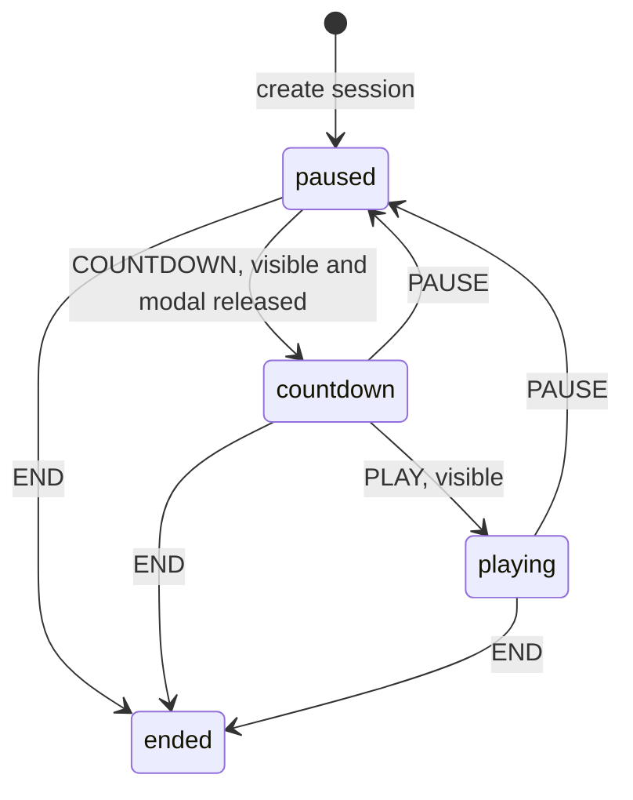

# Kana Rain state machines

This is the inventory of the current production runtime, including state encoded
in flags, nullable objects, timers, DOM visibility, queues and saved evidence.
Independent machines run together: pausing the rain does not pause a save, remove
earned access or reset a reading brake. Static catalogue data and pure rain-speed
calculations are not workflows.

## Implementation decision

Session and import transitions now have explicit tables in `src/game.js`.
Pronunciation requests in `src/audio.js` own their async continuations, and
interface tones in `src/sfx.js` carry a cancellation generation. These changes
address reproducible lifecycle failures while keeping each subsystem's owner.
There is no new runtime dependency or persisted state format.

The remaining machines already have local owners and substantial compatibility
coverage. Their contracts are mapped below. Converting all of them to one global
machine would couple storage, learning evidence, animation and navigation and
make their independent transitions harder to preserve.

## Runtime inventory

| Machine / owner | States and transitions | Contract / regression coverage |
|---|---|---|
| Bootstrap — `game.js`, `learner.js`, `audio.js` | Learner restoration settles before game initialization. Audio manifest independently settles as available/unavailable. | Missing audio cannot prevent play. `core`, `audio-location`, `snapshot-recovery` tests. |
| Session — `game.js`: `SESSION_TRANSITIONS`, `transitionSession` | New session starts paused; countdown → playing; playing/countdown → paused; any live phase → ended. Resume goes through countdown. | One phase derives `paused`, `countingDown`, `over`. Hidden documents and open panels cannot resume play. `lifecycle`, `runtime-performance`, `analytics-game` tests. |
| Panel navigation — `openPanel`, `closePanel`, `panelOrigins` | Title, active game, Pause or Results → Garden/Settings/Help → original destination. Switching panels inherits that destination. Analytics owns a separate native modal. | Active-game return counts down; Pause return stays paused; Results return retains results. Modal ownership blocks programmatic resume. `lifecycle` and browser tests. |
| Device choices and selectors — `renderMenu`, `toggleSound`, `renderSound`, `renderEffects`, `keyboard` | Sound on/off with unavailable capability; normal/reduced effects with an independent OS-motion signal; device typing/sound pad; selected session alphabet and Garden script. User actions change choices; restore/import/reset reconciles saved preferences. | Both sound controls agree. Setup cannot change during a live session; locked Katakana cannot be selected. Sound/effects do not change curriculum or evidence. `single-pace`, `reduced-effects`, `quick-wins`, `import.browser` tests. |
| Practice-event lifecycle — `completeCountdown`, `end`, `analyticsStarted` | Unstarted → started on first completed countdown → completed on explicit end. Disposal without end emits no completion. | Resume/duplicate end cannot repeat practice events. `analytics-game`, `analytics` tests. |
| Typed input — `onInput`, composition handlers, `completePendingAnswer` | Empty/partial input; IME composing; exact ambiguous answer waiting 300 ms of active time; submitted/cancelled. Editing, removal or expiration invalidates the pending round. | Pause/countdown freeze the delay. Timer/waterline resolve an answer entered in time. IME composition is cleared at session boundaries. `runtime-performance`, `lifecycle`, `input.browser` tests. |
| Sound pad — `choosePadFamily`, `resetPad`, `submitComposed` | Families → chosen family's sounds → answer or Back → families. Pad visibility, focus intent and target captured at composition start are independent axes. | Pause preserves composition; expiration clears it; slots remain fixed; delayed pointer bounces cannot skip a stage. `sound-pad`, `quick-wins` tests. |
| Falling round — `spawn`, `wrong`, `hit`, `miss`, `remove` | Created/debut or familiar → falling; wrong submissions stain/accelerate without completing; accepted → pop/removal; expired → heart loss/removal. | One accepted answer or expiration completes a round. Wrong attempts remain separate events. Debut identity lasts until removal. `counting`, `adaptive-rain`, `novelty`, `katakana-feedback` tests. |
| Reading feedback — `flash`, `scheduleFeedback`, `clearFeedback` | Idle → current message; priority interrupts or queues; active-time remainder freezes on pause; expiry advances queue; session boundary clears it. | Corrections cannot be overwritten by lower-priority celebrations. Exposure is recorded when feedback is actually shown. `learning`, `katakana-feedback`, browser tests. |
| Transient presentation — `spirit`, `celebrate`, heart/effect timers | Idle/happy/worried/sleeping spirit; visible milestone/heart cue → timed removal; splash/ripple → removal. | Effects do not own scoring or simulation. Reduced effects skips decorative nodes before allocation. `reduced-effects`, `effects.browser`, browser tests. |
| Render scheduling — `wakeLoop`, `stopLoop`, `renderProgress`, `keyboard` | Animation asleep/queued; progress clean/dirty and hidden/visible; pad unbuilt/built. | Only play/countdown schedules frames; simulation uses active time. Dirty hidden progress stays unrendered until opened. Geometry updates through observers. `runtime-performance`, `production-performance` tests. |
| Feedback-image preparation — `prepareFeedbackImages` | Waiting for load → queued low-priority task → scene settling → feedback files settling in sequence → complete. Hidden/pagehide suspends scheduling; pageshow can continue. | Decode error/timeout settles without blocking input. References stay retained. `effects.browser` tests. |
| Row readiness and access — `readiness`, `checkUnlock`, `unlockKatakana` | Available items unready/ready according to two first hits and 85% accuracy; next row earned; Hiragana complete → Katakana earned. | Earned rows/access are monotonic; later mistakes may change readiness without relocking access. Exploration does not earn rows. `bridge`, `katakana-progression`, `single-pace` tests. |
| Journey curriculum — `journeyStage`, `unlockJourneyMix`, `checkUnlock` | Hiragana → Katakana → mixed, with independent earned access and per-session next-script alternation. | Five Katakana vowels must be presented and ready before mixing. Deferred queues cannot bypass the current stage. `journey` tests. |
| First-presentation admission — `canPresent`, `nextEntry`, `newIds` | Eligible/deferred based on seen state, one debut on screen, three familiar hits of spacing and introduction budget. | Hiragana counts introductions per run; Katakana frees a slot when a new item becomes ready. A starter can bootstrap an empty alphabet. Familiar rain continues behind closed brakes. `novelty`, `katakana-progression` tests. |
| Short recovery — `novelty.js`: `pause`, `finish` | Open → ten familiar first-try hits required after failure; another failure resets ten; qualifying hits decrement to open. | Shared between scripts and saved across runs. Debuts/corrections do not advance recovery. `new-kana-pace`, `novelty`, `journey` tests. |
| Long reading brakes — `novelty.js`: `updateGate` | Open → blocked at two expirations or four familiar misses; blocked → open after the fixed full 60-round/55-hit recovery window meets the limits. | Hiragana/global history and Katakana history are independent; short recovery remains shared. Hysteresis survives restart. `katakana-pressure-migration`, `katakana-progression`, `single-pace` tests. |
| Assistance exposure — `learner.js`: `recordExposure`, `assistanceFor`, `record` | Reference exposed → assisted until both 60 seconds and two distinct assessed items intervene. A round's own recorded assistance stays sticky. | Correcting a revealed answer cannot become independent evidence by waiting. Legacy unknown assistance stays unknown. `learning`, `learner-import`, `bridge` tests. |
| Familiarity and scheduling — `learner.js`: `apply`, `mastery`, `priority`, `selectRound` | New/learning/known/strong estimates change with answers and time; confusion edges grow/decay; repeated lapses flag a leech; scaffolding follows mastery. | These estimates and flags are separate from arcade unlocks. Historical evidence is retained. `core`, `learning`, `content`, consolidation tests. |
| Import UI — `game.js`: `IMPORT_TRANSITIONS`, `transitionImport` | Idle → reading → preview/error; preview → applying → idle on save or preview on failure; cancel/replacement invalidates reads. | Only preview can apply. Applying owns its panel; reading may be superseded. Failure remains retryable. No late read may change another screen or steal focus. `lifecycle`, `import.browser` tests. |
| Import transaction — `learner.js`: `previewImport`, `importProgress` | Validate/preview without writes → capture/journal → serialized merge → persisted or rejected/unsaved. | Additive import preserves preferences and concurrent facts, deduplicates IDs and rejects conflicts. A generation reset invalidates the old operation. `learner-import`, `concurrent-storage`, `import.browser` tests. |
| Persistence bootstrap/status — `learner.js`: `ready`, `publish` | Checking → restored/ready → saving → saved/unsaved; backend availability is an independent axis. Warning persists until an acknowledged save. | A revision token prevents an old transaction replacing newer failure status. Valid copies recover independently. `snapshot-recovery`, `save-batching`, `storage.browser` tests. |
| Save transaction and journal — `capture`, `flush`, `commit`, `finish` | Capture/write-ahead journal → queued lock batch → transaction → complete/abort/fallback → reconciliation. Facts arriving after transaction start create another job. | Every caller journals synchronously. Only the owning writer prunes acknowledged operations. Immutable event IDs unite histories; vectors/timestamps never prove completeness. `save-batching`, `consolidation-regressions`, `concurrent-storage`, native storage tests. |
| Checkpoint and generation — `checkpointSnapshot`, `replace`, `epoch`, `merged` | Checkpoint absent/due/recent, written in a separate best-effort transaction. Explicit reset/replacement advances generation; stale generations cannot restore discarded progress. | Checkpoint failure cannot undo primary commit. Normal import retains generation. `snapshot-recovery`, `mixed-version-storage` tests. |
| Pronunciation — `audio.js`: `play`, `stop` | Idle → loading manifest → starting playback → playing → idle on end/error/stop/mute. A new request replaces the old owner. | Identity checked before and after `Audio.play()`. Old resolve/reject/end cannot succeed or clear a newer request. `audio-lifecycle`, `audio-location` tests. |
| Interface tones — `sfx.js`: `prime`, `play`, `silence` | Context absent/suspended/resuming/running/closed/unavailable; cue scheduled → playing → ended or silenced. | Hidden/mute cancels active voices and invalidates pending continuations. A later resume cannot resurrect an old cue. `sfx`, `music` tests. |
| Menu music — `music.js`: `sync`, `schedule`, `stop` | Waiting for visible menu, enabled sound and running context → intro → looping; pronunciation/effect ducking; mute/hidden/play → fade and cleanup. | No gesture means no context. Delayed cleanup owns its old session. Score scheduling is independent of gameplay time. `music` tests. |
| Analytics — `assets/nihongo-analytics.js` | Consent unknown/denied/accepted with privacy-signal/host guards; tag absent/loading/configured/failed; inactive/active; page-path deduplication and modal focus return. | No analytics before opt-in; withdrawal clears queued commands/cookies; exact payload schema excludes learner data. `analytics`, `analytics-game` tests. |
| Offline installation — `sw.js`, registration in `game.js` | Unsupported/registering/installing → complete cache generation → activating/claimed; install failure retains prior generation. Fetch chooses installed cache or network; status reports ready/unavailable. | Runtime changes receive a new cache identity. Activation alone removes old game caches; learner storage is untouched. `cache-install`, `offline-navigation`, `update.browser`, `partial-update.browser` tests. |

## Session transitions

New sessions allocate a new object. Ended sessions cannot be resumed. Repeated
terminal actions do not record another completion. `cancelCountdown` releases
countdown UI and frame work; it never starts play.

## Inspection and change procedure

`KanaRain.lifecycle` returns a frozen, read-only snapshot containing `session`,
`panel` and `import`. `KanaRain.state.phase` exposes the live session phase;
the established boolean flags remain derived read access. `KanaAudio.state`
reports `idle`, `loading`, `starting` or `playing`. No import contents or learner
history are included in these diagnostics.

Use `start`, `pause`, `end` and `dispose` to change session state. Add session or
import transitions to their owning table and keep side effects in the matching
controller function. Do not assign lifecycle flags or use modal CSS as a second
simulation clock. Keep the persistence protocol and curriculum state independent.

For a workflow change, check entry, duplicate event, cancellation, late async
completion, failure/retry and disposal. For navigation, test return from play,
countdown, Pause, Results and title, with keyboard and touch. Start with
`pnpm test`; `pnpm test:browser` includes the desktop/touch lifecycle checks.
Build before native import/update tests. See [DEVELOPMENT](DEVELOPMENT.md) and
[TESTING](TESTING.md) for the full compatibility checks.

Visibility regressions inject `document.hidden` and dispatch visibility events,
as the existing music tests do. They verify application guards and event ordering;
they do not measure operating-system suspension or background timer throttling.
